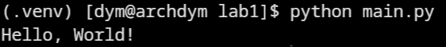

# Звіт до лабораторної роботи №1

## Тема

**Назва лабораторної роботи:** Організація робочого середовища та робота з інтерпретатором мови Python.

## Мета роботи

Підготувати робоче середовище Python, створити окреме середовище для проєкту, встановити необхідні бібліотеки та перевірити налаштування запуском простого Python-файлу.

## Виконання роботи

- створено структуру проєкту лабораторної роботи;
- підготовлено файл `requirements-dev.txt` із залежностями для роботи та тестування;
- реалізовано файл `main.py` із виведенням повідомлення `Hello, World!`;
- перевірено запуск Python-файлу з командного рядка.

## Результат

Посилання на опубліковану сторінку:

```text
https://IlliaDerenevskyi.github.io/tests-labs/
```

Скріншот результату:

```text

```

## Висновок

Під час виконання лабораторної роботи було підготовлено базове Python-середовище, створено файл із залежностями та перевірено коректність запуску програми через командний рядок.
