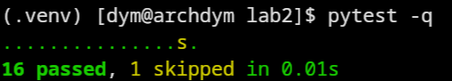

# Звіт до лабораторної роботи №2

## Тема

**Назва лабораторної роботи:** Основи програмування на Python та встановлення сторонніх бібліотек для роботи з Pytest.

## Мета роботи

Навчитися налаштовувати ізольоване тестове середовище у Python, використовувати структуру проєкту `src layout` і розробляти модульні тести з можливостями Pytest.

## Виконання роботи

- створено структуру проєкту з каталогами `src` і `tests`;
- використано бібліотеку **Pytest** та конфігурацію `pytest.ini`;
- реалізовано клас `UserRegistrationValidator` для перевірки email, пароля та віку користувача;
- додано модульні тести позитивних сценаріїв і винятків;
- використано параметризацію, маркер `skipif` та власну фікстуру з підготовкою й очищенням стану через `yield`.

## Результат

Посилання на опубліковану сторінку:

```text
https://IlliaDerenevskyi.github.io/tests-labs/
```

Скріншот результату:





## Висновок

Під час виконання лабораторної роботи було налаштовано тестове середовище Pytest, реалізовано бізнес-логіку валідації користувача та створено комплекс модульних тестів із перевіркою винятків, параметризацією, маркерами й фікстурою.
