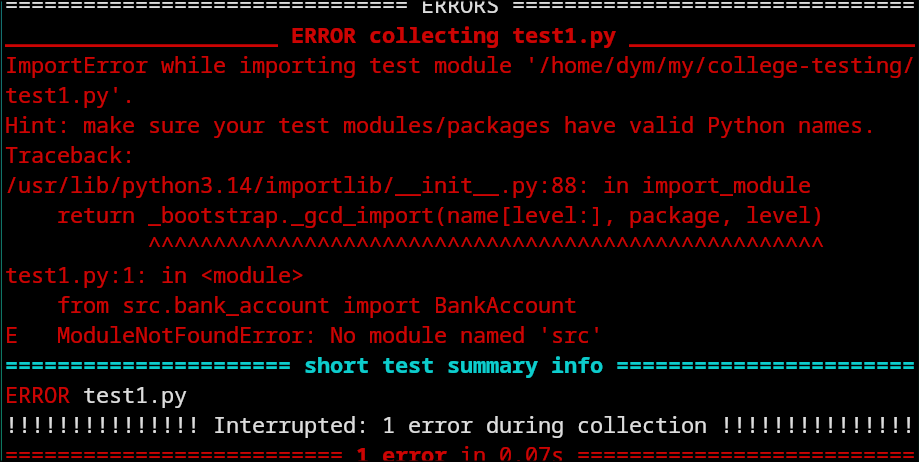
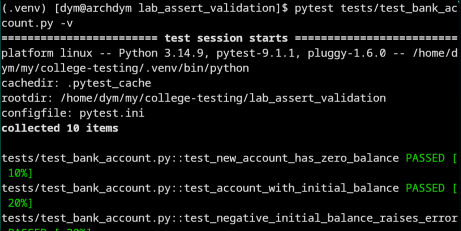
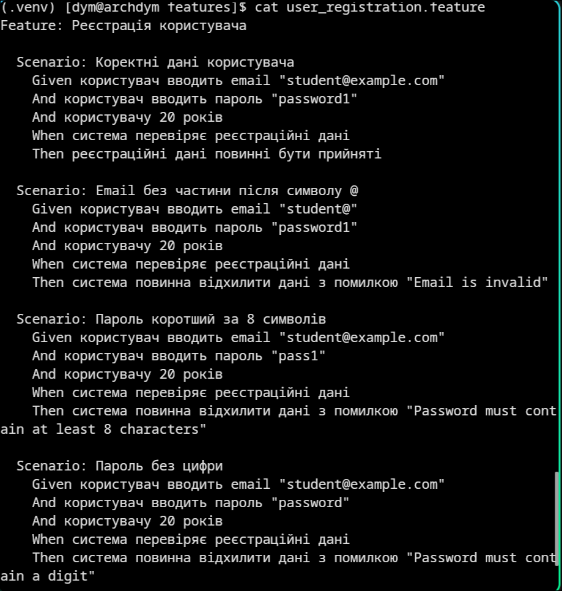
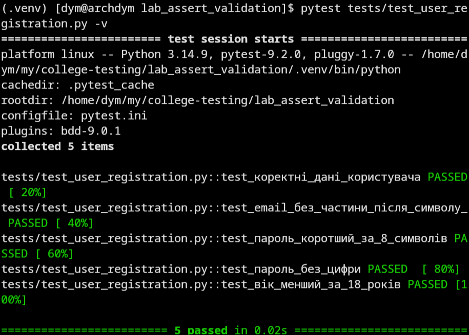
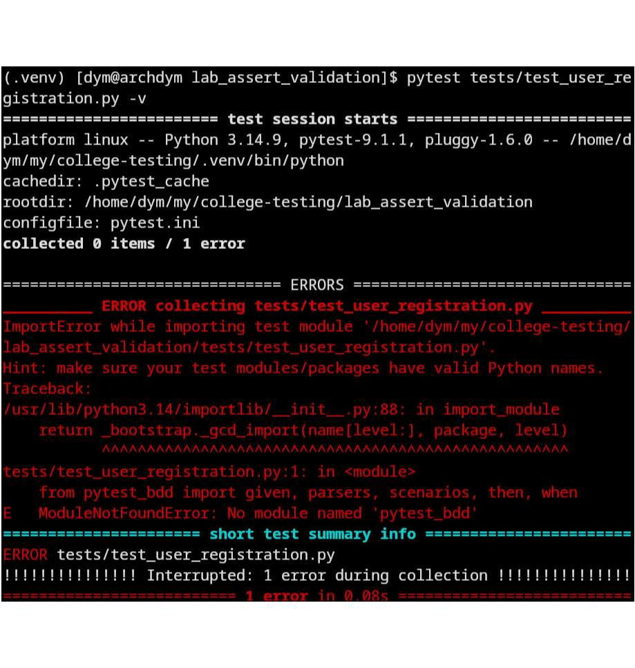

# Звіт до лабораторної роботи №3

## Тема

**Назва лабораторної роботи:** Методи Assert, верифікація та валідація вхідних даних.

## Мета роботи

Навчитися перевіряти результат роботи Python-коду за допомогою pytest, тестувати правильні й неправильні вхідні дані та пройти практичні цикли TDD і BDD.

## Виконання роботи

- створено структуру проєкту з каталогами `src`, `tests`, `features` та конфігурацією `pytest.ini`;
- за методикою TDD (RED → GREEN → REFACTOR) розроблено класи `BankAccount` і `TemperatureConverter`;
- для класу `UserRegistrationValidator` створено BDD-сценарії та step definitions у `pytest-bdd`;
- для класу `DiscountCalculator` додано BDD-сценарії з позитивними й негативними даними;
- використано `assert`, `pytest.approx()` та `pytest.raises()` для верифікації результатів і перевірки винятків.

## Результат

Етап RED — тест не проходить:

Етап GREEN — тест проходить:

Етап REFACTOR — усі тести `BankAccount` проходять:

Feature-файл із першим BDD-сценарієм:

Step definitions Given/When/Then:

Негативний BDD-сценарій до обробки винятку:

Фінальний запуск усіх тестів:

## Висновок

Під час виконання лабораторної роботи через `assert` та `pytest.raises()` було перевірено правильні й неправильні вхідні дані, за циклом TDD розроблено класи `BankAccount` і `TemperatureConverter`, а поведінку `UserRegistrationValidator` та `DiscountCalculator` описано BDD-сценаріями Given → When → Then.
