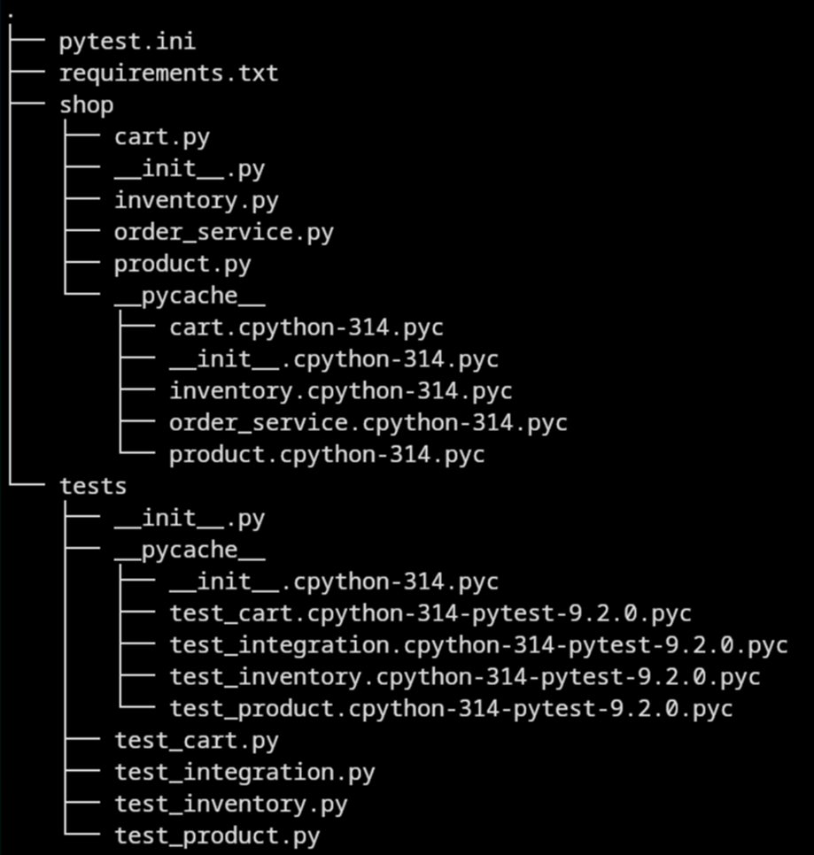
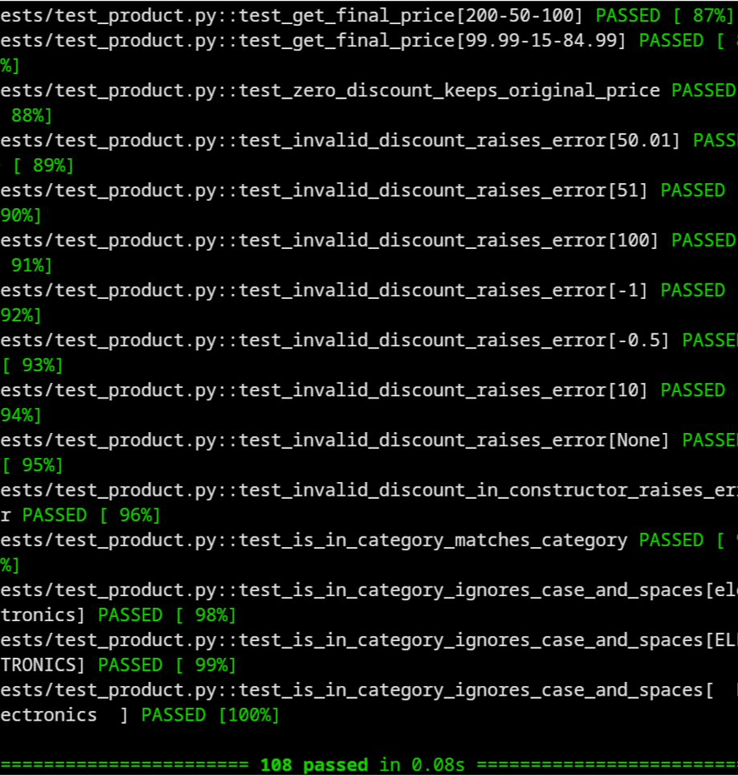
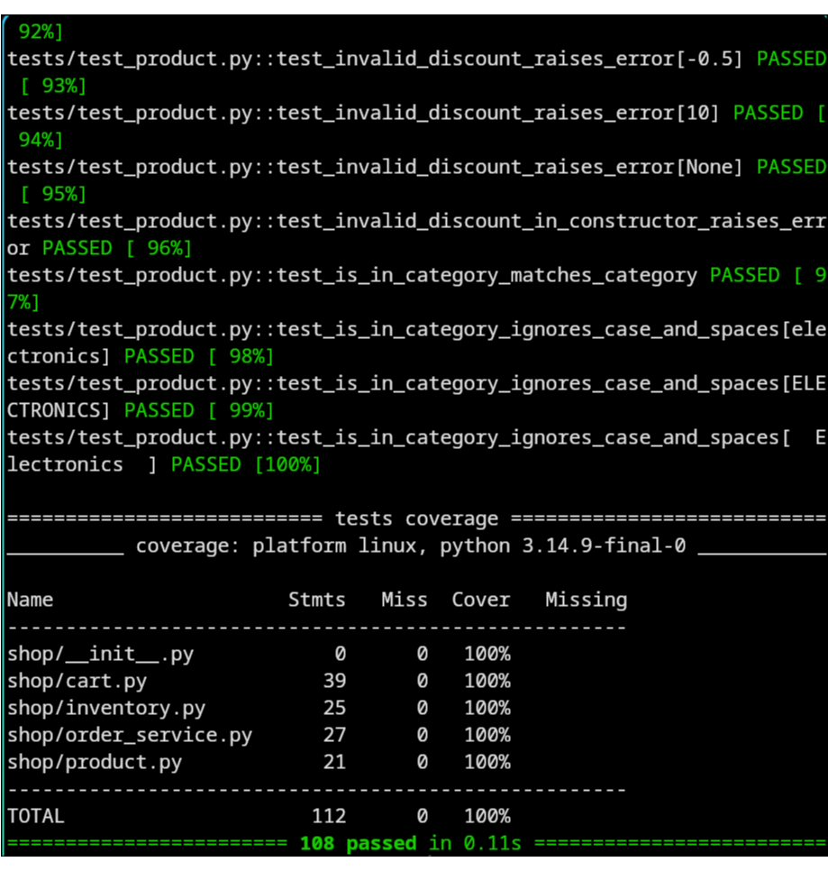
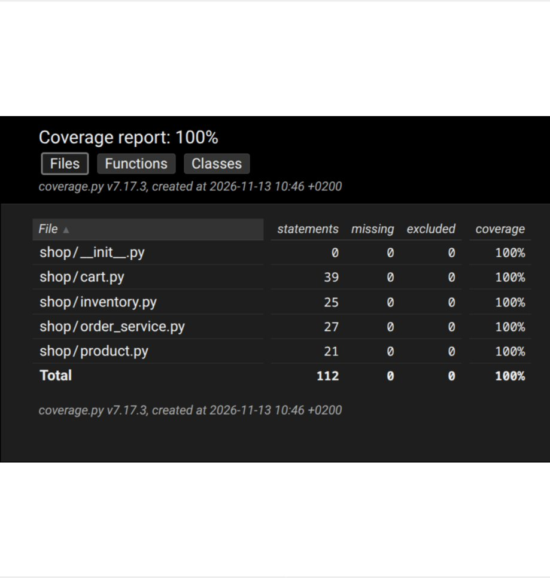
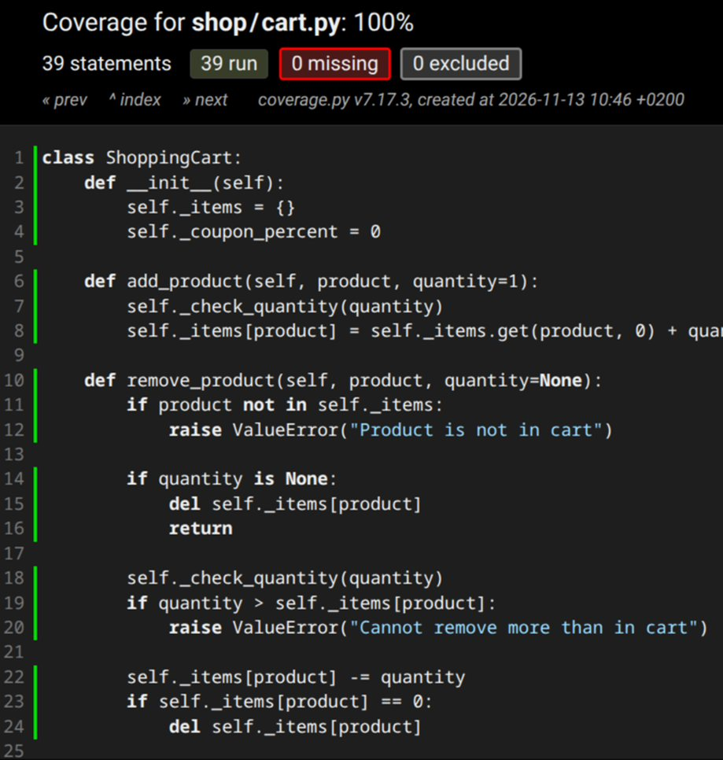
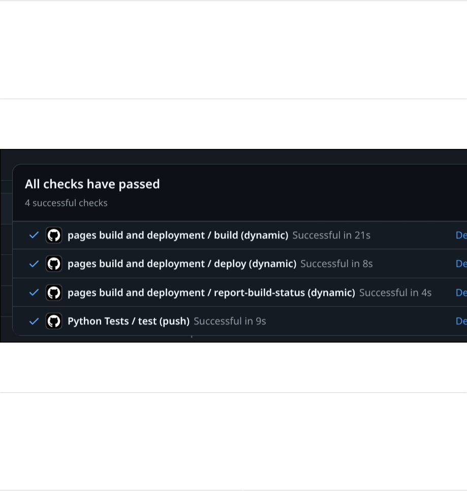
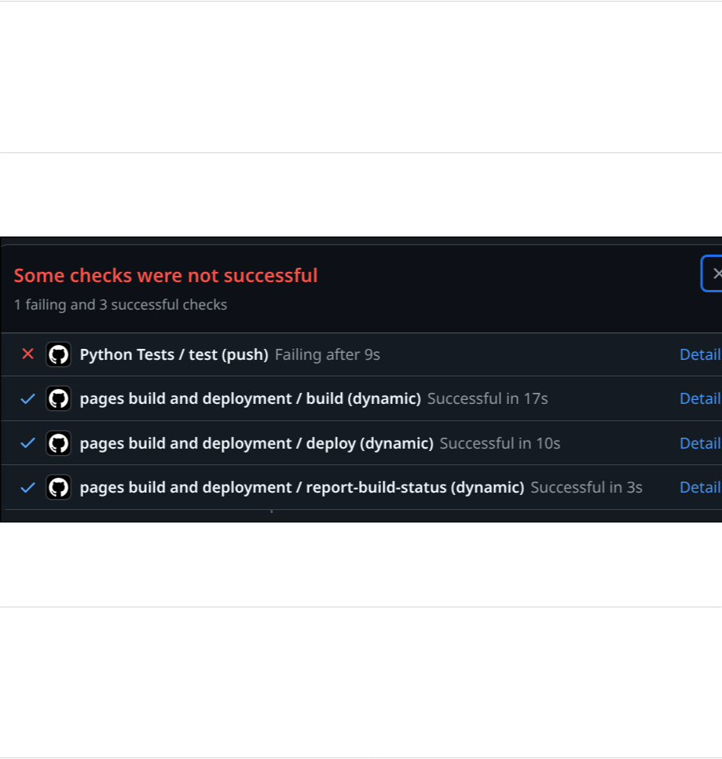

# Звіт до лабораторної роботи №4

## Тема

**Назва лабораторної роботи:** Системні та інтеграційні тести. Автоматизація процесу тестування.

## Мета роботи

Навчитися перевіряти окремі компоненти програми, їхню спільну роботу та автоматично запускати тести після змін у коді.

## Виконання роботи

- створено проєкт `shop_project` із класами `Product`, `ShoppingCart`, `Inventory` та `OrderService`;
- написано unit-тести для `Product`, `ShoppingCart` і `Inventory`;
- написано інтеграційні тести, які перевіряють спільну роботу всіх чотирьох класів без використання моків;
- за допомогою `pytest-cov` визначено покриття коду тестами та створено HTML Coverage Report;
- налаштовано CI через GitHub Actions (`.github/workflows/tests.yml`) і перевірено його реакцію на успішні та помилкові тести.

## Результат

Структура проєкту:

Успішний запуск `pytest`:

Покриття з колонкою Missing (`pytest --cov=shop --cov-report=term-missing`):

Головна сторінка HTML Coverage Report:

Сторінка файлу в HTML Coverage Report:

Підсумкове покриття після додавання тестів:

Успішне виконання GitHub Actions:

GitHub Actions із навмисно зламаним тестом:

## Висновок

Під час виконання лабораторної роботи було написано unit- та інтеграційні тести для навчального інтернет-магазину, проаналізовано покриття коду за допомогою `pytest-cov` і HTML-звіту, а також налаштовано автоматичний запуск тестів у GitHub Actions, який коректно показує як успішні, так і помилкові результати.
